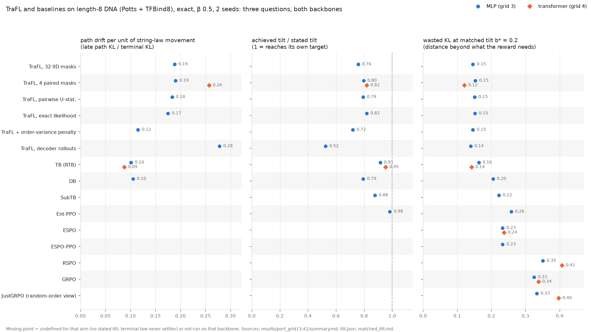
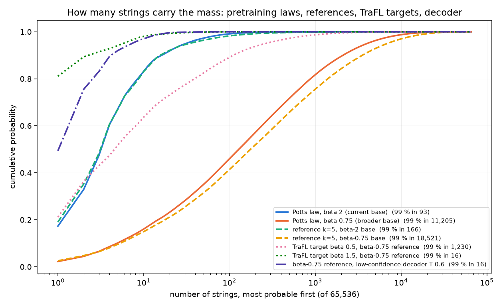
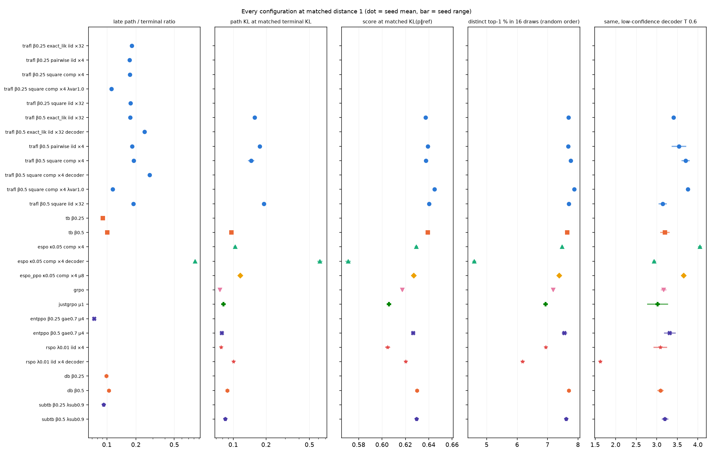

# TraFL and its baselines on length-8 DNA: report

Branch `port-baselines`. Every number below comes from a file in `results/`
or `models/`; exact quantities are computed over all 4⁸ = 65,536 strings and 5⁸ = 390,625 partial strings, not
sampled. Plan and caveats: `INTEGRATION_PLAN.md`, `PORT_NOTES.md`.

*Headline (`scripts/headline_figure.py`). For every method and both backbones at β 0.5:*
- *path drift per unit of string-law movement;*
- *achieved / stated tilt;*
- *wasted KL at a matched tilt.*

*Sections 4b–4c explain each panel.*

## 1. What is compared

The generator is a masked denoiser (MLP, or a transformer) that reveals one position per step.
- **Pretraining:** fit to Metropolis–Hastings samples of a Potts law.
- **Post-training:** toward log R = 3.5 (z_Potts + z_TFBind8). TFBind8 is wet-lab binding of every 8-mer; the Potts
  part is a synthetic pairwise energy.
- **TraFL's target:** p_ref(τ | x) e^{β r(y)}.

| Arm | What its loss scores | How | Target / anchor | Source |
|---|---|---|---|---|
| `trafl` (square, 32 IID / 4 comp masks) | string y | masked ELBO surrogate, Var / K penalty implicit | p_ref e^{βr}, path free | TraFL (this repo's port / the paper's pairs) |
| `trafl --estimator pairwise / split` | y | U-statistic of masked residuals (unbiased, no penalty) | same | bitseq thread |
| `trafl --estimator exact_masks / exact_lik` | y | exact ELBO / exact log p(y) | same | bitseq thread |
| `trafl --var-lambda` | y + order variance | explicit across-order variance penalty | path pulled toward c_ref | gfn_lab S2 fix |
| `espo`, `espo_ppo` | y | ELBO ratio + k2, PPO clip | k2 to p_ref | ESPO (TraFL's baseline) |
| `rspo` | y | ELBO log-ratio regressed on A / λ | implicit (λ) | RSPO |
| `tb` (= RTB), `db`, `subtb` | trajectory τ | exact log P(τ); per-step / sub-trajectory flow | P_ref e^{βr}, path c_ref | GFlowNet balance family |
| `entppo` | τ | soft-RL PPO with RTB's soft reward | P_ref e^{βr}, path c_ref | torchgfn `EntPPOGFlowNet` (adapted) |
| `grpo` | τ | policy gradient on the sampled path | none (max reward) | — |
| `justgrpo` | y via a left-to-right policy | token PPO, KL 0 | none | JustGRPO (TraFL's baseline) |

Rollouts are on-policy from the random-order generator (JustGRPO: left-to-right). `--rollout decoder` samples
training completions with the low-confidence-remasking decoder instead, as TraFL's paper does; this is only allowed
for the per-string arms.

**What the default rollout does and does not imply.**
- **It samples the law that TraFL's loss is defined on.** That law is the model's likelihood, which random order
  samples exactly.
- **It is not needed for correctness.** TraFL's fixed point does not depend on the sampler when every string can be
  drawn, which here is true for both samplers. The sampler changes which strings get trained on, so it affects speed
  and drift, not the target.
- **It is not what TraFL's paper deploys.** The paper decodes with the confidence decoder, and its target says nothing
  about the decoded law. Every metric here is therefore reported under both samplers.
- **This toy may run in the opposite regime from real dLLMs.**
  - Here the decoder at the reference is *worse* on reward than random order: score 0.295 vs 0.401.
  - In LLaDA-type models, confidence decoding is used because it samples better.
  - The decoder-rollout results (grid 3 R4) may therefore not transfer.

Exact metrics at every evaluation:
- terminal KL both ways to the reference, trajectory and path KL;
- score and entropy;
- left-to-right and low-confidence-decoder laws;
- diversity in TraFL's sense: E[distinct strings in 16 draws], overall and among the top 1 % by reward.

## 2. Is the base sound? (`results/foundation/`, figure `foundation.png`)

| | current base (Potts β 2) | broader base (Potts β 0.75) |
|---|---|---|
| pretraining law: strings for 99 % mass | 93 | 11,205 |
| MH sample: distinct strings | 160 (99.4 % of the law) | 2,398 (86 %) |
| reference k = 5: strings for 99 % | 166 | 18,521 |
| learned the law or stored the sample? | indistinguishable (sample = law) | learned: KL(law ‖ ref) 0.10 < KL(sample ‖ ref) 0.42; memorisation index 0.93 |
| TraFL target, strings for 99 %: β 0.5 / 1.5 / 4.5 | 33 / 8 / 1 | 1,230 / 16 / 1 |
| order imbalance KL(c_ref(τ\|y) ‖ uniform) | 0.04 nats | 0.08 nats |
| reference under the low-confidence decoder (T 0.6) | entropy 0.72, 99 % in a handful | entropy 1.58, 99 % in 16, half on one string |

**Choosing the pretraining β.** The values below are exact over all strings with the same couplings. Independent
draws stand in for the MH sample: they give 165 / 2,405 distinct strings where the MH sample has 160 / 2,398.

| β | entropy (nats) | strings for 99 % | distinct in 10,000 draws | law mass they cover |
|---|---|---|---|---|
| 0.5 | 8.76 | 31,913 | 4,803 | 0.68 |
| 0.75 | 6.97 | 11,205 | 2,405 | 0.86 |
| 1 | 5.51 | 3,227 | 1,213 | 0.94 |
| 1.5 | 3.71 | 392 | 383 | 0.98 |
| 2 | 2.83 | 93 | 165 | 0.99 |

- β 2 is the repo's original setting.
- β 0.75 was picked by hand, not by a prior scan, inside the window where the sample covers most of the law's mass
  but not all of it:
  - covering most of it lets the reference learn the law;
  - not covering all of it means learning and storing the sample give different references.

**Verdict.**
- The current base (β 2) is weak for diversity and memorisation questions: its reference is effectively a 100-string
  law, and TraFL's target is a few strings.
- The broader base fixes both: the reference learns rather than stores, and TraFL's target spans about 1,200
  strings at β 0.5. Grid 3 runs on it.
- **On both bases, random-order paths given y are almost uniform.** A well-fit denoiser is nearly order-consistent,
  so "path-law" differences under the random-order sampler measure drift away from near-uniformity.
- The order structure that matters in practice comes from the decoder: confidence-ordered and near-deterministic,
  and already a strong mode-seeker at the reference.
- Readings about paths and diversity are therefore given per sampler.

**Is the decoder's collapse the reference's fault?** (`scripts/decoder_true_law.py`, `decoder_true_law.json`; exact,
broader base.) The decoder is run on four sets of conditionals:

| law | decoder: strings for 99 % | decoder: top string mass | score, random order → decoder | top-1 % distinct in 16, random → decoder |
|---|---|---|---|---|
| true Potts law | 19 | 0.33 | 0.410 → 0.378 | 2.26 → 2.22 |
| reference network (mlp_5) | 16 | 0.49 | 0.401 → 0.295 | 1.83 → 0.36 |
| reference's string law, made order-consistent | 18 | 0.46 | 0.401 → 0.298 | 1.83 → 0.45 |
| TraFL target, β 0.5 | 6 | 0.66 | 0.794 → 0.885 | 9.34 → 3.35 |

- **The concentration is the decoder's own.** It puts 99 % of the true law's mass on 19 strings.
- **The reference decides which strings it concentrates on.** The reference is only KL 0.10 from the law, yet that is
  enough to move the decoder onto low-reward strings: score 0.30 vs 0.38, top-1 % diversity 0.36 vs 2.22.
- **The network's order inconsistency is not the cause:** the consistent version gives about the same.
- **No string has zero decoder probability here.** The exact zeros are in the step (path) law only.
- **Even a perfectly fitted TraFL keeps only a third of its top-string diversity** (3.35 of 9.34) when decoded this way,
  while its score rises.

## 3. Results on the current base (Potts β 2; reference k = 5; 2 seeds)

**Grid 1** (`results/port_grid1/READING.md`; β 1.5, 5,000 updates, all 11 configurations):
- up to terminal KL 1, every TraFL variant has TB's path KL (±7 %);
- the per-string excess appears only at KL 3;
- ESPO drifts at its stationary terminal law (path / terminal 0.08 → 1.6);
- score at matched KL(p ‖ p_ref) is identical across arms (±2 %);
- ESPO is the most diverse at matched KL; GRPO and RSPO lose diversity late;
- the decoder collapses every arm to one string.

**Grid 2, block A** (β ∈ {0.5, 1.5, 4.5}, 10,000 updates, TraFL ×2, TB, DB, SubTB, Ent-PPO). At β 0.5, where the
terminal law settles inside the band, path / terminal by update window:

| arm (β 0.5) | 40–251 | 251–1,585 | 1,585–10,001 |
|---|---|---|---|
| TraFL comp 4 | 0.072 | 0.171 | **0.541** |
| TraFL 32 IID | 0.071 | 0.154 | **0.252** |
| TB (RTB) | 0.061 | 0.053 | 0.036 |
| DB | 0.131 | 0.072 | 0.044 |
| SubTB | 0.067 | 0.065 | — |

- The per-string drift appears exactly where the terminal law is stationary.
- The balance arms move *back* toward the reference's path law.
- At terminal KL 3, TraFL's path KL is 0.37–1.22, against 0.21–0.29 for the four balance arms.
- Comp 4 drifts more than 32 IID at β 1.5, contrary to the variance identity's naive ordering.
- **Under the decoder (endpoints, `results/port_grid2/endpoints_block_a.csv`),** every arm's decoded law at update 10,000 is almost disjoint
  from the reference's (h² ≈ 0.98 at T 0.6) and concentrated on one string. No path comparison survives there on
  this base.
- Blocks B (penalty at β 4.5) and C (references k = 3, 7, transformer d32) were **lost**: kernel `ae-grid2-b` hit
  Kaggle's ≈ 12 h session limit, slowed by its transformer runs (≈ 4–5 h each on Kaggle CPU), and Kaggle kept no
  outputs. The runner now copies each run as soon as it ends. The penalty question moved to grid 3 on the broader
  base. The reference-size question needs a cheaper transformer schedule or a GPU kernel.

**The 4-paired vs 32-independent puzzle** (`scripts/mask_penalty.py`, `mask_penalty.json`). The paper's 4 paired
masks drift more than this repo's 32 independent masks: late ratio 0.54 vs 0.25 at β 0.5. The hypothesis was that
pairing weakens the implicit penalty Var_masks(average); measured, it is refuted.

| on the policy trained by | 32 independent | 4 independent | 4 = 2 complementary pairs | single-mask σ² |
|---|---|---|---|---|
| TraFL 32 IID | 0.0033 | 0.026 | 0.013 | 0.104 |
| TraFL comp 4 | 0.0027 | 0.021 | 0.0086 | 0.085 |

Independent masks give σ²/K. Pairing halves the 4-mask penalty but leaves it 3–4× *larger* than 32 independent
masks, so the drift difference is not the penalty's size. Untested candidates:
- comp pairs never draw the full mask, so they estimate a truncated ELBO with a different fixed point (mean score
  0.063 vs 0.096 on the same completions);
- the anchor in gfn_lab's identity is the variance across *orders*, which a mask-average variance does not measure.

## 4. Results on the broader base (grid 3, 54 runs): see `results/port_grid3/READING.md`

- **TraFL's per-string objectives drift in path law where the terminal law settles.** The balance arms (TB, DB,
  SubTB, Ent-PPO) don't. Late ratio 0.17–0.19 against 0.07–0.10; path KL at matched terminal KL 1 is 1.5–2.4×.
- **The explicit order-variance penalty (λ = 1) removes most of it:** 0.11. The implicit mask variance does not: 32
  IID, 4 paired, pairwise and exact likelihood are all the same.
- **Reward efficiency is the same across arms** (0.61–0.65 at matched KL).
- **Diversity at matched KL:** TraFL and the balance arms ≥ ESPO > GRPO / JustGRPO / RSPO under random order; ESPO
  leads under the decoder.
- **Decoder rollouts, as TraFL's paper samples, raise path drift per unit of terminal movement:** TraFL +40–46 %,
  ESPO 6×.
  - TraFL with them moves only half as far in 10,000 updates (terminal KL 0.55 vs 1.1).
  - ESPO and RSPO lose diversity. For TraFL the diversity change is mixed (READING R4).

## 4b. Method by method: where each one lands, its trained tilt, and the confounds

`python -m src.analysis.tilt` reads every run's final checkpoint exactly, from the empty prompt. Full table:
`results/port_grid3/tilt.md`. Figures: `tilt.png`, `path_by_string.png`, `orders.png`. The quantities:
- **Fitted tilt b\*:** the tilt of the reference, π_b ∝ p_ref e^{b r}, that has the model's expected reward. It equals b
  exactly when p_θ = π_b.
- **Stated b:** the tilt the loss targets at its optimum: 0.8 β for the group-centred arms (TraFL, TB; G = 5), and β for
  the raw-reward arms (DB, SubTB, Ent-PPO).
- **Shape KL:** KL(p_θ ‖ π_b\*), how far the law is from *any* tilt of the reference.

The matched-distance columns are at terminal KL 1, from `summary.md`. β = 0.5 throughout. At β = 0.25, TraFL's b\* /
stated is the same (0.76–0.81), and the balance arms' is 0.06–0.07 lower.

| method | anchor | terminal KL from ref at 10k | b\* (stated) | shape KL | score @ KL 1 | top-1 % distinct, random / decoder @ KL 1 | path KL @ terminal KL 1 | late path / terminal |
|---|---|---|---|---|---|---|---|---|
| TraFL, 4 estimators | p_ref e^{0.8βr}, path free | 0.97–1.12, stationary | 0.30–0.33 (0.40) | 0.12–0.18 | 0.637–0.640 | 7.67–7.76 / 3.1–3.7 | 0.15–0.19 | 0.175–0.19 |
| TraFL + order-variance penalty λ 1 | same, path pulled to c_ref | 0.88 | 0.29 (0.40) | 0.15 | 0.645 | 7.87 / 3.75 | — | **0.115** |
| TraFL, decoder rollouts | same | 0.55, stationary at 30k | **0.21–0.22** (0.40) | 0.12–0.16 | never reaches KL 1 | — | — | 0.25–0.28 |
| TB (RTB) | P_ref e^{0.8βr} on paths | 1.28, creeping | 0.37 (0.40) | 0.09 | 0.639 | 7.65 / 3.2 | 0.10 | 0.10 |
| DB | P_ref e^{βr}, local | 1.65, creeping | 0.40 (0.50) | 0.13 | 0.630 | 7.70 / 3.1 | 0.09 | 0.11 |
| SubTB | same | 1.87, creeping | 0.44 (0.50) | 0.12 | 0.630 | 7.62 / 3.2 | 0.08 | — |
| Ent-PPO | same, soft RL | 2.16 | 0.49 (0.50) | 0.07 | 0.627 | 7.56 / 3.3 | 0.08 | — |
| ESPO, κ 0.05 | k2 to p_ref | 2.64 | 0.42 (none) | **0.46** | 0.629 | 7.48 / **4.05** | 0.10 | — |
| ESPO-PPO, μ 8 | same | 1.87 | 0.35 (none) | 0.38 | 0.627 | 7.39 / 3.65 | 0.12 | — |
| ESPO, decoder rollouts | same | 2.40 | 0.17 | **1.92** | 0.571 | 4.6 / 2.9 | **0.62** | 0.82 |
| RSPO, λ 0.01 | λ, weak here | 18.95, still moving | 2.18 | 0.13 | 0.605 | 6.94 / 3.1 | 0.08 | — |
| RSPO, decoder rollouts | same | 7.44, still moving | 0.46 | 1.82 | 0.620 | 6.18 / **1.63** | 0.10 | — |
| GRPO | none | 22.25, still moving | 2.95 | 0.05 | 0.617 | 7.18 / 3.2 | 0.08 | — |
| JustGRPO, random-order view (wrong lens, confound 4) | none | 12.12, still moving | 0.77 | 1.6 | 0.606 | 6.93 / 3.0 | 0.08 | — |

**Reading.**
- **Reward efficiency at matched distance is 0.61–0.65 for every arm with uniform rollouts.** ESPO with decoder
  rollouts is lower, at 0.57.
- **The anchored, tilt-targeting arms keep the most top-string diversity under random order:** TraFL and the four
  balance arms.
- **ESPO keeps the most under the decoder.**
- **The reward maximisers (GRPO, JustGRPO, RSPO at λ 0.01) lose diversity at the same distance.**
- **TraFL's law is further from a pure tilt than TB's or Ent-PPO's** (shape KL 0.12–0.18 vs 0.07–0.09), and its paths
  drift about 2× more per unit of terminal movement.
- **ESPO's law is not tilt-shaped at all** (shape KL 0.46): its k2 anchor does not target a tilt.
- **Decoder rollouts make every per-string arm less tilt-like:** ESPO's shape KL goes 0.46 → 1.92, RSPO's 0.13 → 1.82.

**The order law** (`orders.png`, top target string):
- Read by random order, the reference, TraFL and TB are all near-uniform over positions. The drift is real (path KL
  0.1–0.2) but spread thin.
- Read by the decoder, post-training rewrites the reveal order completely: the reference's spread order becomes a
  near-deterministic, different one.

**Where the drift sits** (`path_by_string.png`):
- For every arm with a stated tilt, per-string path KL falls with reward, by 2–4× from the lowest to the highest reward
  bin.
- TraFL is above TB and DB at every reward level, except with the order-variance penalty.
- In raw terms SubTB and Ent-PPO reach TraFL's level, but they sit about twice as far from the reference (terminal KL
  1.9–2.2 vs 1.1). Per unit of terminal movement, the late ratio in the table is the fair comparison.

### Is TraFL's effective exponent "good enough"?

- **The centering factor is real but not the whole story.**
  - Centering within the group gives b = β (1 − 1/G) = 0.8 β at G = 5 (PORT_NOTES).
  - The per-token normalisation cancels exactly: the surrogate is log p / u, and the loss uses β / u (`train.py`).
- **TraFL lands at b\* = 0.76–0.82 × 0.8 β, i.e. 0.61–0.65 β.**
  - **It is stationary:** comp 4 gives 0.318 at 10k and 0.325 at 30k (`results/port_grid3_long/tilt.md`).
  - **It does not depend on the estimator:** exact likelihood 0.82, pairwise 0.79, comp 4 0.80, 32 IID 0.76 (of 0.8β).
    So neither the masked surrogate's ELBO gap nor its mask variance causes it.
  - **The explicit penalty lowers it further** (0.69–0.72), as expected of a penalty pulling toward the reference.
- **TB, with the same centering, reaches 0.85–0.91 and is still rising at 10k. Ent-PPO, with raw β, reaches
  0.91–0.98.** TraFL's shortfall is therefore specific to it, or at least larger in it.
- **Candidate cause, untested: on-policy weighting under a shared-parameter model.**
  - The squared residual is fitted where the policy samples.
  - The shortfall doubles when the samples come from the more concentrated decoder: b\* / stated falls from 0.80 to
    0.53–0.55.
- **Practical reading:**
  - TraFL's β is a knob to calibrate, not a temperature to read off. Here b\* ≈ 0.64 β.
  - Compare methods at matched distance or matched b\*, never at nominal β. The same nominal β is a 25 % stronger
    target for the raw-reward arms, and a 20–36 % weaker achieved tilt for TraFL.

### At matched attained tilt (`attained.png`, `matched_tilt.md`; `python -m src.analysis.attained`)

**How b\* is tracked.**
- b\*(t) depends on the model only through E_p[r], which every evaluation logs. So the attained tilt is available at
  every evaluation step, with no checkpoints needed.
- KL(p ‖ π_b\*) then follows from the logged KL(p ‖ p_ref).
- Both reproduce the checkpoint analysis at the final step (asserted).

**At a matched tilt, KL(p ‖ π_b\*) is wasted KL.** Among all laws with the expected reward of π_b, π_b is the one
closest to the reference. Hence KL(p ‖ p_ref) = KL(π_b\* ‖ p_ref) + KL(p ‖ π_b\*): the second term is the distance
spent beyond what that reward needs.

At b\* = 0.2, every uniform-rollout arm gets there within 23–471 updates:

| method | update reached | wasted KL | path KL | top-1 % distinct, random / decoder |
|---|---|---|---|---|
| TraFL, 4 estimators | 399–429 | 0.15 | 0.049–0.053 | 6.2 / 3.75–3.85 |
| TraFL + order-variance penalty | 471 | 0.15 | 0.043 | 6.25 / 4.03 |
| TraFL, decoder rollouts | 2,100–3,600 | 0.12–0.14 | 0.087–0.127 | 6.0–6.1 / 2.2–2.7 |
| TB | 182 | 0.16 | 0.038 | 6.28 / 3.12 |
| DB, SubTB | 155–188 | 0.21–0.22 | 0.043–0.045 | 6.2 / 2.5–2.8 |
| Ent-PPO | 27 | 0.26 | 0.045 | 6.35 / 3.07 |
| ESPO, ESPO-PPO | 23–180 | 0.23 | 0.056 | 6.25 / 3.1–3.2 |
| GRPO, JustGRPO | 92–115 | 0.33 | 0.058–0.060 | 6.2–6.3 / 2.9–3.0 |
| RSPO | 112 | 0.35 | 0.060 | 6.26 / 2.99 |
| RSPO, decoder rollouts | 181 | 0.51 | 0.078 | 6.06 / 1.70 |

**Reading.**
- **At the same attained tilt, random-order diversity is the same for every arm** (6.0–6.35). The diversity gap at
  matched KL is a KL-efficiency gap: the reward maximisers pay more distance for the same reward. Their wasted KL is
  0.33–0.35, against 0.15–0.16 for TraFL and TB.
- **TraFL's string law is as KL-efficient as TB's.**
- **At b\* = 0.2, TraFL's path KL sits between the balance arms and the maximisers:** 0.05, against 0.04 and 0.06. Its
  larger drift at matched KL 1 builds up later, while it sits near its stationary tilt.
- **Under the decoder at matched tilt, TraFL keeps the most top-string diversity:** 3.75–4.03 vs 2.5–3.2. Decoder
  metrics are seed-fragile.
- **Low levels read the first jumps of training.** At b\* = 0.1 (reached in 9–169 updates) all arms are nearly
  identical.
- **High levels carry the time confound in full.** TraFL reaches b\* = 0.3 only asymptotically, after 1,900–6,200
  updates (its stationary b\* is 0.30–0.33), against 55–710 for the others. The penalty and decoder-rollout variants
  never reach it.
- **So b\* = 0.2 is the fairest single level here.** A matched-tilt reading is still a first-crossing reading.

### Confounds, most damaging first

1. **Time at distance.** "Path KL at matched terminal KL" compares arms that *pass through* KL 1 early (GRPO, JustGRPO,
   RSPO, ESPO, within a few hundred updates) with TraFL, which *settles* there for thousands of updates. Path drift
   accumulates while the terminal law is stationary. So TraFL vs the reward maximisers on path KL is confounded. The
   fair path comparison is TraFL vs TB / DB / SubTB / Ent-PPO by late ratio, since they all settle at 1.1–2.2.
   Matched attained tilt has the same problem at high levels. At a mid level (b\* = 0.2) TraFL's path KL is between
   the balance arms' and the maximisers'.
2. **Unanchored arms are not at a fixed point.**
   - GRPO, JustGRPO and RSPO at λ 0.01 are still moving at 10k (terminal KL 12–22). Their final-checkpoint numbers
     (b\* 2–3, score 0.92–0.95) measure training length, not a target. Only their matched-distance numbers mean
     anything.
   - RSPO's λ is the paper's and was not tuned. In this toy it is effectively unanchored.
3. **One setting per non-β arm, no sweeps.** ESPO (κ 0.05), RSPO (λ 0.01), ESPO-PPO (μ 8) are each one point on their
   own frontier. "Method X is less diverse" means "at this setting". Matched distance removes the "how far" part, not
   the "which frontier" part.
4. **JustGRPO is read through the wrong lens in most columns.**
   - **Its protocol** (arXiv 2601.15165, §5–6): it is trained as a left-to-right policy built on a dLLM backbone
     (LLaDA-Instruct). It is evaluated with the LLaDA protocol: low-confidence remasking in semi-autoregressive blocks of
     32, one token per step.
   - **So its training law is the left-to-right law, and its deployment law is the confidence decoder's** (here one
     block of 8). The random-order law is neither.
   - **At 10k the lenses disagree sharply** (final checkpoints, exact):
     - its left-to-right and decoder laws are the same collapsed string (entropy 0.16 / 0.00, TV 0.03 apart);
     - its random-order law is still broad (entropy 2.1, 6.0 distinct top-1 % strings in 16 draws), TV 0.61 from its
       left-to-right law.
   - **Its b\*, shape-KL and random-order diversity entries in this section therefore overstate its spread.** On its
     own laws it collapses like GRPO.
   - **Reward efficiency on its training law:** 0.615 at left-to-right KL 1 (random-order view 0.606). That equals
     GRPO and is below TraFL and TB (0.63).
   - **For every other arm the lenses agree:** left-to-right vs random-order TV ≤ 0.28 (reference 0.14). In this toy the
     left-to-right order has no special status, so the toy cannot test JustGRPO's premise that AR order has more
     reasoning potential in language. It tests only the mechanics.
5. **Different targets at the same β.** Centred arms target 0.8 β, raw arms β (25 % stronger). This is handled by b\*
   and by matched distance, but any nominal-β comparison is wrong.
6. **Convergence differs.** TraFL is stationary at 10k. TB, DB and SubTB are still creeping, so their shortfall in
   b\* is partly unconverged.
7. **Evaluation prompt ≠ training prompts.** All exact metrics are from the empty prompt. Training uses random partial
   strings, often off the reference's support.
8. **Gradient steps per update differ** (ESPO-PPO μ 8, Ent-PPO μ 4) on the per-update x-axis.
9. **The toy's regime.** At the reference, the decoder is worse on reward than random order, the reverse of real
   dLLMs (§1), and there is one reward, one reference and 2 seeds. Seed ranges are tight (±3 %) for random-order
   metrics, but decoder-level metrics are seed-fragile: decoder TV to the decoded target is 0.30 vs 0.73 for the two
   TraFL comp 4 seeds at 30k.

## 4c. Same methods on a transformer backbone (grid 4; `results/port_grid4/READING.md`)

**Setup.**
- Reference = start: transformer d32, 26k parameters, pretrained on the broader base (KL 0.14 from the law; it learns
  rather than stores).
- Arms: TraFL comp 4, TB, ESPO, RSPO, GRPO, JustGRPO; grid 3's settings; 2 seeds; run locally.

| method | b\* / stated, MLP → transformer | wasted KL @ b\* 0.2 | late path / terminal | score @ KL 1 |
|---|---|---|---|---|
| TraFL | 0.80 → 0.82 | 0.15 → 0.12 | 0.19 → 0.26 | 0.637 → 0.629 |
| TB | 0.91 → 0.95 | 0.16 → 0.14 | 0.10 → 0.09 | 0.639 → 0.618 |
| ESPO | — | 0.23 → 0.24 | — | 0.629 → 0.607 |
| GRPO | — | 0.33 → 0.34 | — | 0.617 → 0.611 |
| JustGRPO (random-order view) | — | 0.33 → 0.40 | — | 0.606 → 0.593 |
| RSPO | — | 0.35 → 0.41 | — | 0.605 → 0.595 |

**What carries over from the MLP:**
- the ordering in KL efficiency (wasted KL);
- TraFL drifting more than TB (3× on the transformer).

**What does not:** which arm keeps the most top-string diversity under the decoder. It depends on the backbone and the
matching (READING, corrected 2026-10-18).

**TraFL's under-tilt does not depend on the backbone** (0.82 of the stated tilt), while TB comes within 5 % of its
stated tilt.

**JustGRPO's views drift further apart on the transformer:** its left-to-right and decoder laws are one string, and its
random-order law has entropy 3.8–4.4.

**ESPO's path drift is backbone-sensitive:** 0.28 vs 0.10 at matched terminal KL 1.

## 5. Correctness

- **Tests:** 97, each a mathematical identity or a comparison against an independent exact computation. Mutation
  checks: each new gate was made to fail by breaking its target.
- **Bit-for-bit continuity:** TraFL (`--arm trafl`, defaults) reproduces the pre-port code bit for bit.
- **Independent review** (Sonnet, read-only): no sign, normalisation or indexing error in the losses. It found and
  I fixed:
  - table rows overwritten when configurations differed only in shared settings;
  - the AR-decoder KL compared against the wrong reference law;
  - split / pairwise U-statistics biased under the dependent comp masks (now rejected);
  - matched interpolation dropping float-noise points;
  - SubTB NaN for empty trajectories;
  - β / u applied to the extensive `elbo` surrogate (a pre-existing line);
  - tests that only exercised ratio = 1 / λ = 1 (clipped branches and GAE λ < 1 now tested).

## 6. Limits

- One reward and one reference family per base; 2 seeds.
- The decoder here commits one token per step, with no top-p.
- Results speak to this toy, not to 8B models.
- Matched comparisons interpolate between checkpoints; the per-update x-axis mixes gradient steps for the
  multi-epoch arms (Ent-PPO μ 4, ESPO-PPO μ 8).
